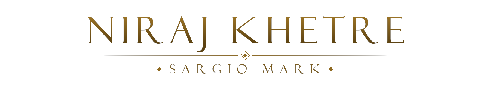
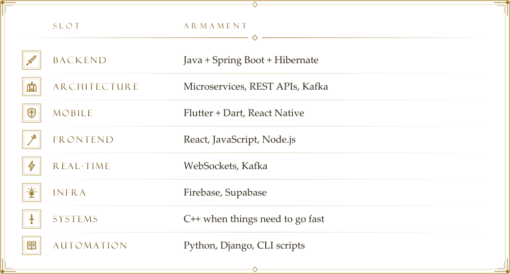

  <picture>
    <source media="(prefers-color-scheme: dark)" srcset="assets/title-dark.png">
    
  </picture>

<h1 align="center">&nbsp;Rise, Tarnished. I'm Niraj</h1>

> I don't just write code — I ship products. Currently building apps that real people use, while still figuring out `O(n log n)` in class.

##  Legacy Dungeons

**What I'm Building** · *Conquered, and still standing.*

- &nbsp;**[SpurSpace](https://spurspace.in)** — Social app for real-world connections. MVP shipped to Play Store. Real-time chat, activity feeds, community features. 
- &nbsp;**[SMP369](https://github.com/nirajkhetre/SMP-369-Plugin)** — Custom Minecraft server plugin — GUIs, shops, spawners, RTP, the works 
- &nbsp;**[Avalon](https://github.com/Adityasawant1/Avalon)** — Environmental monitoring & sustainability platform (Team Project) 

##  Equipment

**The Stack I Actually Use** · *Equip load: medium. Still rolls fast.*

<picture>
  <source media="(prefers-color-scheme: dark)" srcset="assets/stack-panel-dark.svg">
  
</picture>

##  The Golden Order

**What I Care About** · *Tenets I'd defend against any Demigod.*

- **Shipping > Planning** — I'd rather have a buggy MVP than a perfect Figma
- **Clean architecture** — but only when it earns its complexity
- **Sustainability tech** — building for a planet that needs better software
- **Learning in public** — I break things, fix them, and sometimes write about it

##  Summon Sign

**Open To** · *My summon sign is down. Summon me for:*

- &nbsp;Software Engineering Internships
- &nbsp;Backend Developer (Spring Boot)
- &nbsp;Flutter / Backend Freelance
- &nbsp;Collaborative projects that solve real problems

##  Site of Grace

**Connect** · *Rest here, then send word:*

&nbsp;Messages left by other Tarnished · <i>Random Facts</i>

- &nbsp;Builds Minecraft plugins for fun
- &nbsp;Currently deep in Kafka & distributed systems
- &nbsp;Shipped an app to Play Store
- &nbsp;Believes tech should leave the planet better than it found it

> **"Be wary of premature abstraction"** · Appraised 369 times

> *"Ship it, learn from it, iterate."*

&nbsp; <i>Grace guides the MVP</i> &nbsp;

